


 

 

  


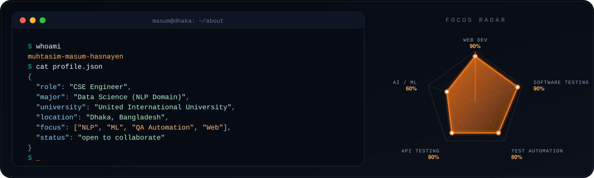

 



  

  

 


 

 


<table>
<tr>
<td width="33%" align="center"><a href="https://github.com/Muhtasim-Masum-Hasnayen/CoverCraft"></a></td>
<td width="33%" align="center"><a href="https://github.com/Muhtasim-Masum-Hasnayen/Academic-Hub-UIU"></a></td>
<td width="33%" align="center"><a href="https://github.com/Muhtasim-Masum-Hasnayen/Ticket_Management_System"></a></td>
</tr>
<tr>
<td width="33%" align="center"><a href="https://github.com/Muhtasim-Masum-Hasnayen/my-portfolio"></a></td>
<td width="33%" align="center"><a href="https://github.com/Muhtasim-Masum-Hasnayen/wishora"></a></td>
<td width="33%" align="center"><a href="https://github.com/Muhtasim-Masum-Hasnayen?tab=repositories"></a></td>
</tr>
<tr>
<td width="33%" align="center"><a href="https://github.com/Muhtasim-Masum-Hasnayen?tab=repositories"></a></td>
<td width="33%" align="center"><a href="https://github.com/Muhtasim-Masum-Hasnayen?tab=repositories"></a></td>
<td width="33%" align="center"><a href="https://github.com/Muhtasim-Masum-Hasnayen?tab=repositories"></a></td>
</tr>
</table>

Tap a card to open the repository &nbsp;·&nbsp; <a href="https://github.com/Muhtasim-Masum-Hasnayen?tab=repositories">see all repositories →</a>

 


 


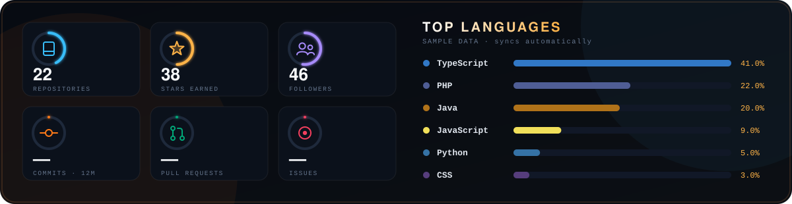

  

 


  

